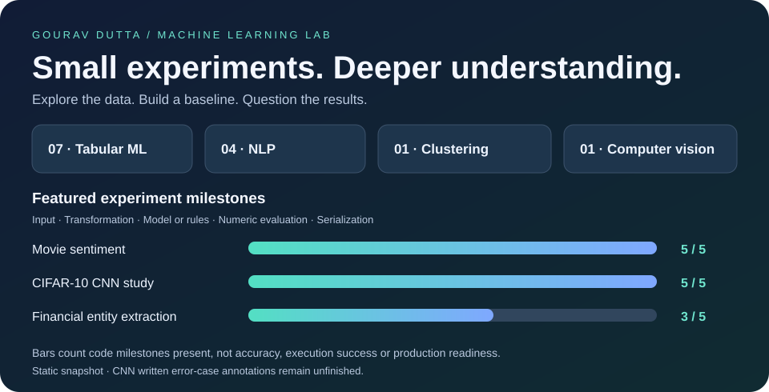
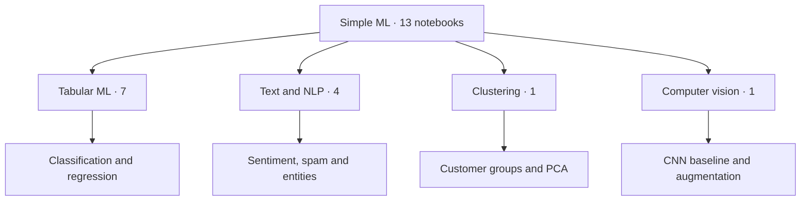
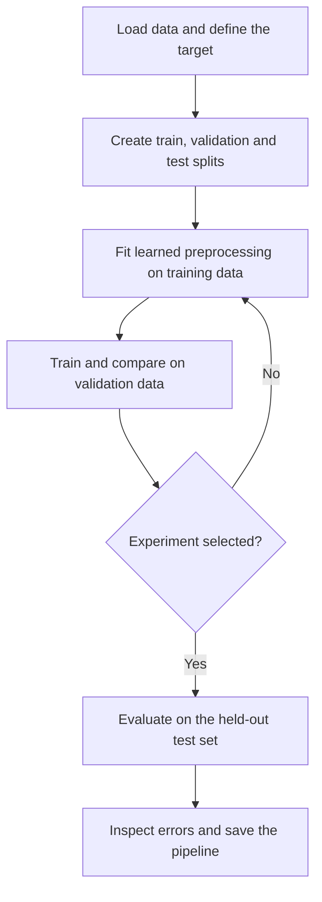

# Simple ML



<p align="center">
  A growing collection of small, practical Machine Learning projects built in Jupyter Notebook.
</p>

<p align="center">
  
  
  
  
</p>

---

## About

**Simple ML** is a personal collection of machine-learning experiments focused on learning by building.

The notebooks cover supervised learning, unsupervised learning, NLP, image classification, preprocessing, model evaluation, visualization, and model comparison. The goal is to build a strong ML foundation while continuously improving earlier models as new techniques are learned.

Most projects are designed to be explored through **Jupyter Notebook**, with some notebooks originally developed in Google Colab or Kaggle. Each notebook records an experiment that can be revisited as new techniques are learned.

## Projects

| Notebook | Focus |
|---|---|
| [`Customer_Segmentation.ipynb`](Customer_Segmentation.ipynb) | Customer segmentation using **K-Means clustering** and **PCA** |
| [`Diabetes_Prediction.ipynb`](Diabetes_Prediction.ipynb) | Diabetes classification using **SVM** and feature scaling |
| [`Finance_NLP.ipynb`](Finance_NLP.ipynb) | Financial NLP with **spaCy**, identifying companies, stocks, indexes and exchanges |
| [`Forest_Fire.ipynb`](Forest_Fire.ipynb) | Forest-fire classification with models such as **Logistic Regression** and **SVC** |
| [`Heart_Failure.ipynb`](Heart_Failure.ipynb) | Heart-failure prediction, preprocessing and classification evaluation |
| [`Houses.ipynb`](Houses.ipynb) | House-price prediction using **Linear Regression** |
| [`Movie_review_sentiment.ipynb`](Movie_review_sentiment.ipynb) | IMDB sentiment classification using **TF-IDF**, **Logistic Regression**, **LinearSVC** and **Random Forest**, with misclassified-review inspection and model export |
| [`Songlikes.ipynb`](Songlikes.ipynb) | Song-like classification using **Logistic Regression** |
| [`Spam_sms.ipynb`](Spam_sms.ipynb) | SMS spam detection using **TF-IDF** and multiple classification models |
| [`Spam_sms_sim.ipynb`](Spam_sms_sim.ipynb) | A simpler SMS spam classifier using **CountVectorizer + Multinomial Naive Bayes** |
| [`Stocks.ipynb`](Stocks.ipynb) | Stock-data analysis and regression experiments |
| [`Student_Placements.ipynb`](Student_Placements.ipynb) | Student placement classification using **Logistic Regression** |
| [`imageclassification.ipynb`](imageclassification.ipynb) | CIFAR-10 study comparing a baseline **TensorFlow/Keras CNN** with **data augmentation**, including training curves, per-class metrics, error-case inspection and paired-seed experiment code |

### 🧭 Choose a learning path



**Suggested starting points:** [Simple SMS](Spam_sms_sim.ipynb) for text classification, [Diabetes](Diabetes_Prediction.ipynb) for a small tabular classifier, [Customer segmentation](Customer_Segmentation.ipynb) for unsupervised learning, and the [CNN study](imageclassification.ipynb) for experimental deep learning.

### 🔎 Inside the projects

Expand a project to see its question, implementation and learning value. **Suggested next steps are proposed improvements, not claims of completed work.**

<details>
<summary><strong>🧩 Customer segmentation</strong> — what it does and what to learn</summary>

[Open notebook](Customer_Segmentation.ipynb)

- **Question:** Discover groups of customers with similar characteristics without predefined class labels.
- **Approach in the notebook:** K-Means groups customers by similarity; StandardScaler brings numerical features onto comparable scales, while PCA helps represent high-dimensional patterns.
- **What I am learning:** Understand why feature scales change distance-based clustering and why a cluster number needs interpretation.
- **Suggested next step:** Assess cluster stability and separation, then describe each group using its original features.

</details>

<details>
<summary><strong>🩺 Diabetes classification</strong> — what it does and what to learn</summary>

[Open notebook](Diabetes_Prediction.ipynb)

- **Question:** Predict the dataset's diabetes label from tabular measurements.
- **Approach in the notebook:** A support-vector classifier learns a decision boundary after feature scaling; the notebook computes training and test accuracy.
- **What I am learning:** Learn classification, scaling and the difference between training performance and generalization.
- **Suggested next step:** Fit scaling only on the training split and add recall, F1 and a confusion matrix.

</details>

<details>
<summary><strong>🏦 Financial entity extraction</strong> — what it does and what to learn</summary>

[Open notebook](Finance_NLP.ipynb)

- **Question:** Identify companies, stock symbols, indexes and exchanges in financial text.
- **Approach in the notebook:** spaCy's EntityRuler matches patterns built from TSV reference tables; displaCy highlights matched entities.
- **What I am learning:** Understand rule-based NLP, domain vocabulary and why ambiguous names create false matches.
- **Suggested next step:** Build a manually labelled text sample and measure entity precision and recall.

</details>

<details>
<summary><strong>🌲 Forest-fire classification</strong> — what it does and what to learn</summary>

[Open notebook](Forest_Fire.ipynb)

- **Question:** Classify fire-related records from the Algerian forest-fires dataset.
- **Approach in the notebook:** Logistic Regression, SVC, a scaled SVC pipeline and Random Forest are compared with classification metrics.
- **What I am learning:** Compare model families and examine the effect of preprocessing.
- **Suggested next step:** Consolidate repeated cells and save the chosen model with a filename that matches its estimator.

</details>

<details>
<summary><strong>❤️ Heart-failure records</strong> — what it does and what to learn</summary>

[Open notebook](Heart_Failure.ipynb)

- **Question:** Explore classification using clinical-record data.
- **Approach in the notebook:** The notebook includes Logistic Regression, SVC, Decision Tree, Random Forest, XGBoost and Gradient Boosting, with search-based tuning and evaluation.
- **What I am learning:** Learn pipelines, hyperparameter search, ensemble methods and confusion-matrix interpretation.
- **Suggested next step:** Keep tuning separate from the final test set and document the target and limitations clearly.

</details>

<details>
<summary><strong>🏠 House-price regression</strong> — what it does and what to learn</summary>

[Open notebook](Houses.ipynb)

- **Question:** Estimate a continuous house-price target from housing features.
- **Approach in the notebook:** Exploratory plots and distribution analysis lead into a Linear Regression experiment.
- **What I am learning:** Distinguish regression from classification and connect feature distributions with prediction errors.
- **Suggested next step:** Add residual analysis and a clearly documented held-out regression comparison.

</details>

<details>
<summary><strong>🎬 Movie-review sentiment</strong> — what it does and what to learn</summary>

[Open notebook](Movie_review_sentiment.ipynb)

- **Question:** Classify IMDB reviews as positive or negative.
- **Approach in the notebook:** TF-IDF unigrams and bigrams feed Logistic Regression, LinearSVC and Random Forest. The notebook inspects false positives and false negatives and exports the SVC and vectorizer.
- **What I am learning:** Understand sparse text features, model comparison and why reading misclassified examples matters.
- **Suggested next step:** Package preprocessing, vectorization and classification together so inference follows the training path.

</details>

<details>
<summary><strong>🎵 Song preferences</strong> — what it does and what to learn</summary>

[Open notebook](Songlikes.ipynb)

- **Question:** Predict a song-like label from the supplied song dataset.
- **Approach in the notebook:** The experiment compares Logistic Regression, SVC, Random Forest and boosting models using classification metrics.
- **What I am learning:** Explore how different estimators handle the same feature set and target.
- **Suggested next step:** Document the label meaning and consolidate model results into one reproducible comparison.

</details>

<details>
<summary><strong>✉️ SMS spam experiments</strong> — what it does and what to learn</summary>

[Open notebook](Spam_sms.ipynb)

- **Question:** Separate spam messages from legitimate messages.
- **Approach in the notebook:** NLTK text preprocessing and TF-IDF support Naive Bayes and other classifiers, including voting and stacking experiments; model and vectorizer export code is included.
- **What I am learning:** Study text normalization, ensemble comparison and precision when false spam alarms matter.
- **Suggested next step:** Use a consistent training-only preprocessing pipeline and inspect both false alarms and missed spam.

</details>

<details>
<summary><strong>📨 Simple SMS baseline</strong> — what it does and what to learn</summary>

[Open notebook](Spam_sms_sim.ipynb)

- **Question:** Build a compact first text-classification experiment.
- **Approach in the notebook:** CountVectorizer turns messages into word counts; Multinomial Naive Bayes predicts labels, evaluated with accuracy, precision, recall and F1.
- **What I am learning:** See the full text-to-features-to-prediction sequence with fewer moving parts.
- **Suggested next step:** Compare this baseline with the richer SMS notebook using the same split and evaluation setup.

</details>

<details>
<summary><strong>📈 Stock-data regression</strong> — what it does and what to learn</summary>

[Open notebook](Stocks.ipynb)

- **Question:** Explore regression relationships in downloaded stock data.
- **Approach in the notebook:** yfinance supplies data for Linear Regression, Lasso, Ridge and SVR experiments with MSE, RMSE and R² evaluation.
- **What I am learning:** Understand regularization, regression metrics and why time order matters in market data.
- **Suggested next step:** Use chronological evaluation and compare against a simple baseline before interpreting forecasting value.

</details>

<details>
<summary><strong>🎓 Student placement</strong> — what it does and what to learn</summary>

[Open notebook](Student_Placements.ipynb)

- **Question:** Predict a placement label from a student dataset.
- **Approach in the notebook:** Logistic Regression and a scaled SVM experiment provide a supervised classification comparison, including hyperparameter search.
- **What I am learning:** Practice splitting data, scaling features and interpreting accuracy alongside precision.
- **Suggested next step:** Document dataset provenance and evaluate which features or errors influence the result.

</details>

<details>
<summary><strong>🖼️ CIFAR-10 image classification</strong> — what it does and what to learn</summary>

[Open notebook](imageclassification.ipynb)

- **Question:** Test whether augmentation improves a CNN's performance on unseen images.
- **Approach in the notebook:** Compare the same CNN with and without horizontal flips and translations. The code includes matched initial weights, validation-loss checkpoint selection, training curves, per-class metrics, ten selected error cases and three paired seeds.
- **What I am learning:** Learn controlled experiments, overfitting, checkpoint selection, training-time measurement and variation across seeds.
- **Suggested next step:** Fill the ten blank written error observations and explanations; verify the paired-run outputs before making final result claims.

</details>

### 📊 Progress through experiment milestones

The bars in the overview graphic count five concrete **code milestones**: input handling, feature transformation, model/rule execution, numerical evaluation and serialization/export. They are a static documentation snapshot, not model accuracy, project completion percentages or proof that every cell runs successfully.

| Featured notebook | Input | Transform | Model / rules | Numeric evaluation | Export code | Milestones |
|---|:---:|:---:|:---:|:---:|:---:|---|
| [Movie sentiment](Movie_review_sentiment.ipynb) | ✅ | ✅ | ✅ | ✅ | ✅ | **5 / 5** |
| [CIFAR-10 CNN](imageclassification.ipynb) | ✅ | ✅ | ✅ | ✅ | ✅ | **5 / 5** |
| [Financial NLP](Finance_NLP.ipynb) | ✅ | ✅ | ✅ | — | — | **3 / 5** |

**Evidence behind the counts:** Movie sentiment includes TF-IDF, classifier metrics and `joblib.dump`; the CNN includes augmentation, classification reports, checkpoints and CSV/JSON exports; financial NLP builds EntityRuler patterns and highlights matches but does not include a labelled quantitative evaluation or pipeline export.

**Still open in the CNN study:** the ten written visual-observation and possible-explanation pairs remain blank. Training and repeated-run code are present; the bars do not mark those annotations or the whole study as finished. Export code also does not mean generated files are committed to this repository.

### 🧠 Understand the results

| Experiment type | What the output means | Useful questions to ask |
|---|---|---|
| Classification | A predicted class, such as spam or not spam | Which class is missed? What do precision, recall and the confusion matrix reveal? |
| Regression | A predicted numerical value | How large are the errors in target units? Does the model beat a simple baseline? |
| Clustering | Groups based on feature similarity | Are groups stable, interpretable and sensitive to scaling? |
| Rule-based NLP | Text spans matched to named entity categories | Which valid mentions are missed, and which ambiguous phrases are incorrectly matched? |
| CNN comparison | Test results for baseline and augmented image models | Was augmentation the main change? Were checkpoints selected on validation data? Is the gain consistent across seeds? |

## Tech Stack

- Python
- Jupyter Notebook
- NumPy
- pandas
- Matplotlib
- Seaborn
- scikit-learn
- spaCy
- NLTK
- XGBoost
- TensorFlow / Keras
- joblib
- Plotly
- SciPy
- WordCloud
- yfinance

## Running Locally

### 1. Clone the repository

```bash
git clone https://github.com/yupitsmegd7/Simple_ML.git
cd Simple_ML
```

### 2. Create a virtual environment

**Windows**

```bash
python -m venv .venv
.venv\Scripts\activate
```

**Linux / macOS**

```bash
python3 -m venv .venv
source .venv/bin/activate
```

### 3. Install the common dependencies

```bash
pip install jupyter numpy pandas matplotlib seaborn scikit-learn spacy nltk xgboost joblib plotly scipy wordcloud yfinance
```

For `imageclassification.ipynb`, also install TensorFlow with `pip install tensorflow`. A GPU can reduce training time, especially for the repeated CNN experiments. Some notebooks may require additional packages or NLTK resources depending on the experiment.

### 4. Start Jupyter

```bash
jupyter notebook
```

Open the notebook you want to explore, select the Python environment containing the dependencies, and run the cells in order. Review dataset inputs and output paths before starting training.

> **Note:** Some notebooks use Colab-style dataset paths such as `/content/...`, while the CNN study saves checkpoints and reports under `/kaggle/working/...`.  
> Dataset files are not bundled in this repository. Supply the CSV/TSV files expected by your chosen notebook and update its input paths. The CNN notebook downloads CIFAR-10 through Keras and requires internet access on the first run. When running locally, replace Kaggle output paths with a writable local directory and create it before saving files.

## Typical Workflow

Most notebooks follow a simple ML workflow:

```text
Dataset
   ↓
Cleaning / Preprocessing
   ↓
Exploratory Data Analysis
   ↓
Feature Engineering
   ↓
Train / Test Split
   ↓
Model Training
   ↓
Evaluation
   ↓
Prediction / Experimentation
```

For new supervised experiments, use this evaluation sequence to keep held-out data separate:



Fit scalers and vectorizers on training data only. For time-dependent data, respect chronological order. This is a guide for future improvements; individual learning notebooks may need refactoring to follow it fully.

## What This Repository Is For

This repository is primarily a learning space for:

- understanding ML algorithms by implementing them
- comparing different models and studying the effect of data augmentation
- practicing preprocessing and feature engineering
- working with real datasets
- learning evaluation metrics, inspecting errors and tracking training time
- experimenting with NLP, clustering and CNN-based image classification
- gradually improving models and notebooks over time

## License

This project is available under the [MIT License](LICENSE).

---

<p align="center">
  Built while learning, experimenting, and getting better at Machine Learning.
</p>
